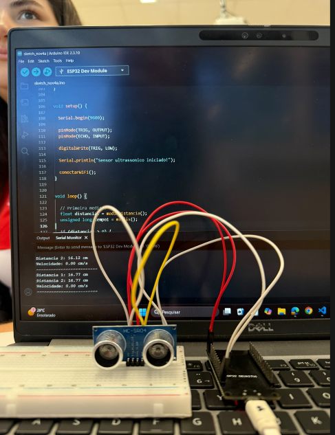
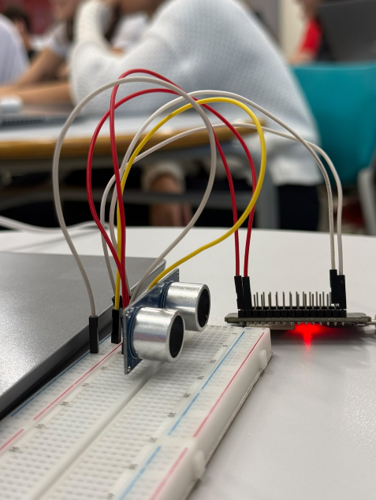
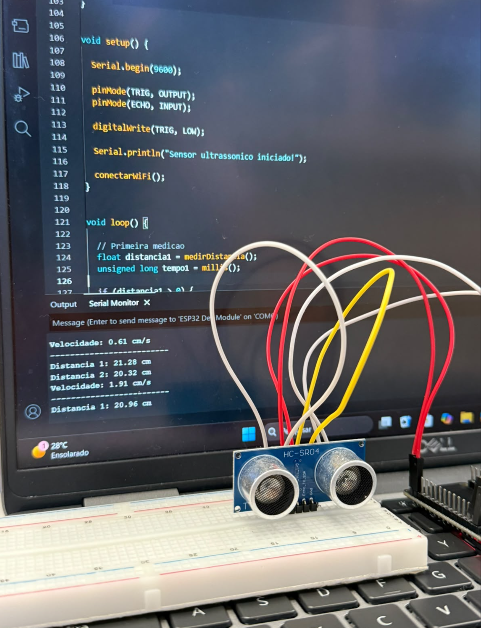

# ⋆ SENSOR DE ULTRASSOM ⋆
Protótipo IoT capaz de detectar a distância de uma pessoa ou objeto, calcular a velocidade de aproximação/afastamento e enviar os dados para uma API em tempo real.

## ⋆ Imagens do Projeto
<p align="center">
  
  
  
</p>

## ⋆ Objetivo do Desafio
1. Mostre a distância no monitor serial
2. Leia a distância duas vezes em um intervalo de meio segundo
3. Calcule a velocidade e mostre no monitor serial


## ⋆ Código
```cpp
#include <WiFi.h>
#include <HTTPClient.h>

// Wi-Fi
const char* ssid = "TI_SENAI2";
const char* senha = "senai2025";

// API
const char* servidor = "http://192.168.1.144:3000";

// Sensor ultrassom
const int TRIG = 23;
const int ECHO = 22;

// Controle Wi-Fi
unsigned long ultimaTentativaWiFi = 0;
const unsigned long intervaloWiFi = 10000;

// Medir distancia
float medirDistancia() {
  for (int tentativa = 0; tentativa < 3; tentativa++) {
    digitalWrite(TRIG, LOW);
    delayMicroseconds(2);
    digitalWrite(TRIG, HIGH);
    delayMicroseconds(10);
    digitalWrite(TRIG, LOW);
    long duracao = pulseIn(ECHO, HIGH, 30000);
    if (duracao > 0) {
      float distancia = duracao * 0.0343 / 2;
      if (distancia >= 2 && distancia <= 400) {
        return distancia;
      }
    }
    delay(60);
  }
  return -1;
}

// Conectar ao Wi-Fi
void conectarWiFi() {
  Serial.println("Conectando ao Wi-Fi...");
  WiFi.mode(WIFI_STA);
  WiFi.setAutoReconnect(true);
  WiFi.begin(ssid, senha);
  unsigned long inicio = millis();
  while (WiFi.status() != WL_CONNECTED && millis() - inicio < 15000) {
    delay(500);
    Serial.print(".");
  }
  Serial.println();
  if (WiFi.status() == WL_CONNECTED) {
    Serial.println("Wi-Fi conectado!");
  } else {
    Serial.println("Wi-Fi nao conectado.");
  }
  ultimaTentativaWiFi = millis();
}

// Enviar velocidade para API
void enviarVelocidade(float velocidade) {
  if (WiFi.status() == WL_CONNECTED) {
    HTTPClient http;
    http.begin(servidor);
    http.addHeader("Content-Type", "application/json");
    String json = "{";
    json += "\"velocidade\":" + String(velocidade, 2) + ",";
    json += "\"unidade\":\"cm/s\"";
    json += "}";
    http.POST(json);
    http.end();
  }
}

void setup() {
  Serial.begin(9600);
  pinMode(TRIG, OUTPUT);
  pinMode(ECHO, INPUT);
  digitalWrite(TRIG, LOW);
  Serial.println("Sensor ultrassonico iniciado!");
  conectarWiFi();
}

void loop() {
  // Primeira medicao
  float distancia1 = medirDistancia();
  unsigned long tempo1 = millis();
  if (distancia1 > 0) {
    Serial.print("Distancia 1: ");
    Serial.print(distancia1);
    Serial.println(" cm");
  } else {
    Serial.println("Primeira medicao invalida.");
  }
  delay(500);

  // Segunda medicao
  float distancia2 = medirDistancia();
  unsigned long tempo2 = millis();
  if (distancia2 > 0) {
    Serial.print("Distancia 2: ");
    Serial.print(distancia2);
    Serial.println(" cm");
  } else {
    Serial.println("Segunda medicao invalida.");
  }

  // Calcular velocidade
  if (distancia1 > 0 && distancia2 > 0) {
    float maior = max(distancia1, distancia2);
    float menor = min(distancia1, distancia2);
    float tempo = (tempo2 - tempo1) / (1000.0 * 3600.0);
    float velocidade = ((maior - menor) / (100 * 1000)) / tempo;
    Serial.print("Velocidade: ");
    Serial.print(velocidade);
    Serial.println(" Km/h");
    enviarVelocidade(velocidade);
  } else {
    Serial.println("Nao foi possivel calcular a velocidade.");
  }

  // Reconectar ao Wi-Fi
  if (WiFi.status() != WL_CONNECTED && millis() - ultimaTentativaWiFi >= intervaloWiFi) {
    WiFi.begin(ssid, senha);
    ultimaTentativaWiFi = millis();
  }

  Serial.println("-------------------------");
  delay(2000);
}